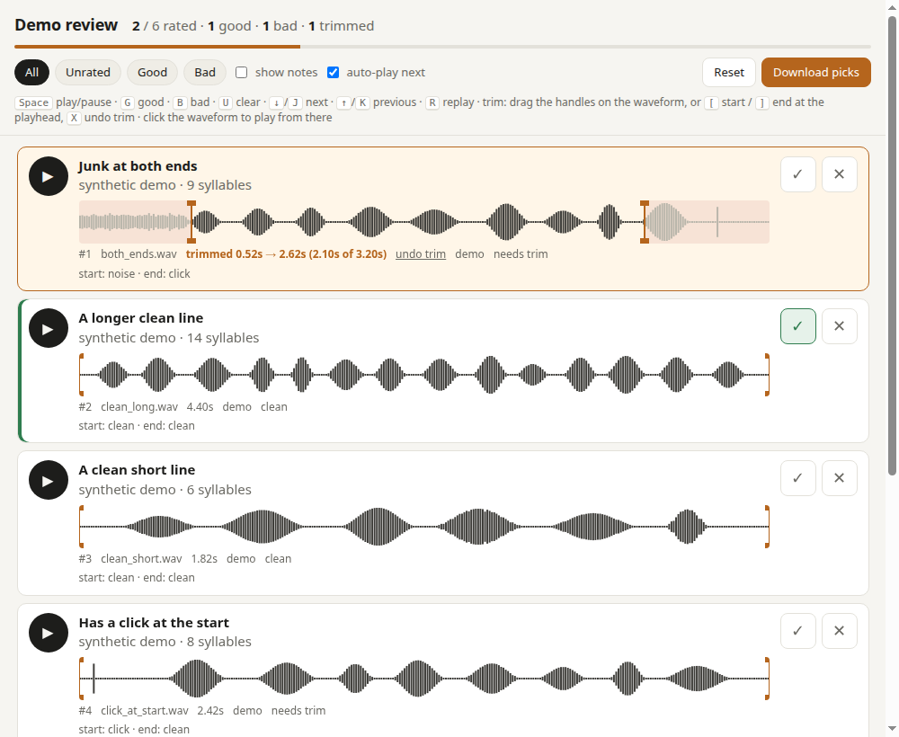

# audio2prompt

Turn a large pool of speech (a folder or a Hugging Face dataset) into clean, ear-checked prompt clips
for zero-shot TTS / voice cloning, all on a CPU and in your browser:

1. **Screen**: score every clip with two tiny CPU models and shortlist the best N (default 200).
2. **Clean**: remove silences, and drop clips without enough speech left.
3. **Review**: listen in a local review app; mark each clip good or bad, trim or cut what's wrong,
   check its transcript (Gemini fills it in) and give it a label.
4. **Publish**: download the dataset (audio + `metadata.csv`) or push it straight to Hugging Face.



## Quick start

```bash
git clone https://github.com/GhanaOpenAI/audio2prompt.git
cd audio2prompt
pip install -r requirements.txt            # + `pip install datasets` for Hugging Face input

# a folder of clips, or a Hugging Face dataset:
python screen.py --folder path/to/clips --top 200 --language "Asante Twi"
python screen.py --hf user/dataset --split train --text-column text --top 200 --language Ewe
```

When it's done, the review app opens in your browser at **http://localhost:8765**. It runs on your
machine through a small local server (`serve.py`, Python standard library), which saves your work to
`shortlist/progress.json` as you go, transcribes clips with Gemini and publishes the dataset. The page
only works this way; opened as a plain file it just tells you how to start the server.

- Already have a set of clips and don't need screening? `python build.py path/to/clips` cleans them and
  opens the review app the same way.
- Come back to a review later: `python serve.py shortlist` (or the folder you used).
- Gemini transcription needs a key in `$GEMINI_API_KEY` or `~/.gemini_api_key`; without one,
  everything else works.
- Try it on synthetic demo clips: `python example/make_demo.py && python build.py example/audio --meta example/clips.csv --out example/review`.

Options shared by `screen.py`, `build.py` and `serve.py`: `--port` (8765), `--language` (spoken
language for Gemini), `--model` (Gemini model), `--no-browser`, `--host 0.0.0.0` to share on your
network. `--build-only` (build/screen) writes the folder without starting the server.

## Screening a big pool (CPU only)

```bash
pip install -r requirements.txt            # + `pip install datasets` for Hugging Face input

python screen.py --folder path/to/clips --top 200
python screen.py --hf user/dataset --split train --audio-column audio --text-column text --top 200
# -> opens the review app; files in shortlist/ (clips/, index.html, screening.csv, progress.json)
```

Each clip goes through two small ONNX models, with no PyTorch and no GPU. They're downloaded once to
`~/.cache/audio2prompt` and checksum-verified:

| model | size | what it measures |
|---|---|---|
| [Silero VAD](https://github.com/snakers4/silero-vad) v5 | 2.3 MB | where the speech is: trims silence off both ends, longest pause inside the speech, share of the clip that is speech |
| [DNSMOS](https://github.com/microsoft/DNS-Challenge/tree/master/DNSMOS) P.835 | 1.2 MB | predicted listener scores (1–5): **SIG** speech quality, **BAK** background (higher = cleaner), **OVRL** overall |

Length is measured **without silences**, the way the review page presents a clip: silent ends
trimmed and every pause of `--min-gap` 0.3 s or more shortened to `--keep-gap` 0.15 s. Clips are
**rejected** if that cleaned length is under `--min-duration` (3 s), if less than `--min-speech-ratio`
(75 %) of it is speech, or if they clip. DNSMOS only runs on clips that survive the VAD checks, which is what keeps it fast.
The rest are **ranked** by `--rank-by` (default `bak+ovrl`, favouring clean backgrounds) and the top
`--top` are written edge-trimmed to `shortlist/audio/`, cleaned into `shortlist/clips/`, and opened for review.
`screening.csv` lists every clip scanned with its scores and the reason for any rejection.

Speed: about **24 clips/s on a 6-core laptop CPU** for typical 2–8 s clips (folder input), roughly
85,000 clips an hour. Hugging Face input is usually limited by download speed.

Clips longer than `--max-duration` (10 s) can still be shortlisted; the review page makes you trim
them before they can pass. `--reject-longer-than` (30 s) drops very long clips outright.

## Quick start

```bash
git clone https://github.com/GhanaOpenAI/audio2prompt.git
cd audio2prompt
pip install -r requirements.txt          # numpy, soundfile

# try it on the synthetic demo clips
python example/make_demo.py
python build.py example/audio --meta example/clips.csv --out example/review --title "Demo review"
# open example/review/index.html in your browser
```

On your own data:

```bash
python build.py path/to/clips                       # -> review/index.html
python build.py path/to/clips --meta clips.csv      # show transcripts / notes next to each clip
python build.py path/to/clips --copy --out review   # copies audio in, so you can zip and share the folder
python build.py path/to/clips --min-duration 2 --max-duration 15   # allowed kept length (defaults 3 and 10 s, 0 = off)
```

## Building a review from your own clips

```bash
python build.py path/to/clips                       # -> review/ and opens the review app
python build.py path/to/clips --meta clips.csv      # show transcripts / labels / notes from a metadata file
python build.py path/to/clips --min-duration 2 --max-duration 15   # allowed kept length (defaults 3 and 10 s, 0 = off)
```

## Reviewing

| Key | Action |
|---|---|
| `Space` / `Enter` | play / pause |
| `G` / `B` | mark good / bad, then jump to the next clip and play it |
| `U` | clear the rating |
| `↓` `J` / `↑` `K` | next / previous clip |
| `R` | replay |
| `[` / `]` | set trim start / end at the playhead |
| `A` | remove the detected silences in this clip (if you undid the automatic pass) |
| `Delete` / `C` | with both markers around a middle part: cut that part out |
| `X` | undo all trims and cuts on the clip |

- **You review clips with their silences already removed.** `build.py` finds the speech in every clip
  with Silero VAD (CPU, the same model `screen.py` uses), trims the silent ends (keeping `--edge-pad`
  0.1 s) and shortens every pause of `--min-gap` 0.3 s or more *in the middle* to a natural
  `--keep-gap` 0.15 s. The cleaned audio is written to `<out>/clips/` and that's what the page shows
  and plays.
- **Only viable clips are shown.** A clip's real length is its length without silences. Clips under
  `--min-duration` once silences are removed, or with no speech at all, are left out of the page
  entirely; `<out>/precut.csv` lists every clip with its original and cleaned length and why it was
  hidden. Clips over `--max-duration` are shown, but must be trimmed before they can pass.
- Prefer the original audio? `--no-precut` shows it unmodified and removes silences in the page
  instead (each detected silence is a dotted box; `A` or "remove N silences" applies them, `X` undoes).
  `--silences off` skips detection altogether.
- **Trimming the ends:** drag the orange handles on a clip's waveform. Trimmed-off parts are shaded.
- **Cutting something out of the middle** (a cough, a stray word, a pause) uses the same orange
  markers: move both of them around the part you don't want. Under the waveform,
  **✂ Cut this part out instead** appears; click it (or press `Delete` / `C`) and that part is cut, and the
  markers jump back to the ends, ready for the next cut. If you don't click it, the markers simply
  trim, keeping only the part between them.
  Cut ranges stay visible, crossed out; click one to restore it. On export the pieces are joined with
  a 10 ms crossfade so the join doesn't click.
- **Playback only covers what you're keeping**: it starts at the trim start, jumps over cuts and stops
  at the trim end, so you hear exactly what will be exported.
- **Transcript and label for every clip you pass:** a clip marked ✓ good gets a **✎ Transcript**
  button (or press `T`) and a label field.
  - The transcript opens in a popup with a ▶ Play button, the text, and the suggestions available
    (Gemini's, and the text the clip came with), each with **Use**. Save with the button or `Ctrl+Enter`.
    The row shows whether the text is still Gemini's / your data's or **✔ checked** by you.
  - Under the text, a character pad has the letters of Ghanaian orthographies and IPA that most
    keyboards lack (ɛ ɔ ŋ ɖ ƒ ɣ ʋ ɩ ʊ ʒ ɲ, Hausa ɓ ɗ ƙ ƴ, ə ɪ ɨ ʉ ɑ ʃ ʔ ɡ ɟ ɸ β), ⇧ for capitals, and
    tone/nasal marks (◌́ ◌̀ ◌̂ ◌̌ ◌̃ ◌̄) that attach to the letter before the cursor. Click to insert.
  - Labels are free text, so you don't need any loaded, but every label you type becomes a choice in
    the field's dropdown, so you only type it once. Pre-fill labels from your metadata with
    `--label-col` (default `label`).
- **Allowed length:** what a clip keeps after trims and cuts must be between `--min-duration` and
  `--max-duration` (defaults **3 s** and **10 s**, the usual range for voice-cloning reference audio).
  - Too short, whether it started short or you trimmed it down: **marked bad automatically**, ✓ disabled.
    Extend the trim back past the minimum and the automatic "bad" is lifted (a "bad" you chose yourself stays).
  - Too long: ✓ stays disabled until you **trim it down** to the maximum or less.
- **Click the waveform** to play from that point.
- **Filters:** All / Unrated / Good / Bad. Use *Unrated* to work through what's left.
- **Notes are hidden by default** so automatic checks don't bias your ears; tick *show notes* to see them.
- **Progress is saved as you go** to `<review>/progress.json` (and in the browser), so it survives other
  browsers, cleared browser data and restarts. Rebuilding with the same title and files keeps it.
  **Download picks** / **Load picks** move a review between machines or merge a colleague's.
- **Download picks** saves `picks.json`; **Load picks** reads one back in (to resume on another machine,
  merge a colleague's review, or carry progress over to a rebuilt page). Keys can be file paths or clip numbers.

```json
{ "good": ["a.wav"], "bad": ["b.wav"], "unrated": ["c.wav"],
  "trims": { "a.wav": [0.52, 4.62] }, "cuts": { "a.wav": [[1.9, 2.4]] },
  "transcripts": { "a.wav": "Me pɛ sɛ wo ba ha" }, "labels": { "a.wav": "greeting" },
  "min_duration": 3.0, "max_duration": 10.0 }
```

## Automatic transcription with Gemini

```bash
export GEMINI_API_KEY=...                         # or put it in ~/.gemini_api_key
python serve.py review --language "Asante Twi"    # (screen.py / build.py take --language too)
```

With a key, the review app sends every clip you mark ✓ good to Gemini, **as trimmed and cut at that
moment**, and fills in its transcript; you open ✎ Transcript to correct it. "↻ Transcribe again" in the popup re-runs it after you change the cuts. The key stays in
the `serve.py` process (the page never sees it), results are cached in `review/gemini_transcripts.json`,
and `--model` picks the Gemini model (default `gemini-flash-latest`). Without a key, `serve.py` just
serves the page.

To transcribe a whole folder up front instead: `python transcribe.py path/to/clips --language Ewe`
(writes `transcripts.csv`).

## Download the dataset or push it to Hugging Face

- **⬇ Download dataset**: a `dataset.zip` with `audio/*.wav` and `metadata.csv`.
- **🤗 Push to HF**: paste a Hugging Face token with write access (or click "use the account
  logged in on this computer"), pick your account or one of your organizations from the dropdown,
  edit the dataset name (pre-filled from the page title), choose private or public, and push. The
  token only goes to the local `serve.py` process, for that session; it isn't saved anywhere. The
  repo gets a short dataset card if it doesn't have one, and pushing again replaces the clips and
  metadata.
- **✨ Transcribe passed clips**: sends every passed clip without a transcript yet to Gemini, e.g. ones
  you passed before turning transcription on.

Both use the Hugging Face "audiofolder" layout, so the result loads directly:

```python
from datasets import load_dataset
ds = load_dataset("your-org/your-dataset", split="train")   # or load_dataset("audiofolder", data_dir="dataset")
# columns: audio, transcription, label, duration_sec, source_file, start_sec, end_sec, cuts
```

## Exporting from the command line

```bash
python apply_picks.py picks.json review/clips dataset/                       # good clips -> audio/ + metadata.csv
python apply_picks.py picks.json review/clips dataset/ --include-unrated     # plus the ones you skipped
# (pass the folder the page played from: <out>/clips, or your original folder with --no-precut)
```

It writes the same `audio/` + `metadata.csv` layout as the download button. Clips outside the allowed length after trimming are skipped (the limits
saved in `picks.json`, or `--min-duration` / `--max-duration`).

## Metadata file

Optional. A `.csv`, `.json` (list of objects) or `.jsonl` with one row per clip, matched on file
name or relative path:

| column | shown as |
|---|---|
| `file` | the clip to match (required) |
| `text` | bold line, e.g. the transcript |
| `subtitle` | line under it, e.g. a translation |
| `tags` | small labels (`;`-separated in CSV, or a list in JSON) |
| `label` | pre-fills the editable label |
| `notes` | hidden until *show notes* is ticked, e.g. automatic QC results |

Different column names? Map them: `--text-col transcript --subtitle-col english --notes-col qc`.

## Notes

- Supported formats: anything [soundfile](https://python-soundfile.readthedocs.io) can read:
  WAV, FLAC, OGG/Opus, MP3, AIFF.
- The review folder is self-contained once silences are pre-cut (the default): `clips/`, `index.html`,
  `progress.json`. With `--no-precut`, the page plays your original files; keep them where they were
  (or use `--copy`).
- The server listens on 127.0.0.1 only unless you pass `--host`. Audio and keys stay on your machine;
  Gemini (when you use it) and Hugging Face (when you push) are the only outside services.

## License

MIT. The screening models are downloaded from their own projects at run time and keep their own
licences ([Silero VAD](https://github.com/snakers4/silero-vad/blob/master/LICENSE): MIT;
[DNSMOS](https://github.com/microsoft/DNS-Challenge): see that repository).
